# Lotería Push

Práctica 15: ejercicio guiado de TDD (desarrollo guiado por pruebas) con Flutter y Node, sobre notificaciones push con Firebase Cloud Messaging (FCM).

- Alumno: Oscar Manuel Ayala Ortiz
- N.C. 1225100784, grupo GTID244
- Materia: Desarrollo de Aplicaciones Móviles
- Docente: Anastacio Rodríguez García

## Qué es

La lotería mexicana jugada con el celular. Uno de los jugadores es el **cantor**: crea la sala y canta las cartas. Los demás se unen con el código de la sala, reciben su tabla de 4×4 y, cada vez que se canta una carta, les llega una notificación push con la carta y una pista chistosa. Las cartas que salen en su tabla se marcan con un frijol 🫘 y, cuando completan una fila, columna, diagonal, las esquinas, el centro o la tabla llena, pueden cantar **¡LOTERÍA!**.

La lotería es el pretexto; lo que se practica es hacer bien el push: quién manda las notificaciones (un servidor, nunca la app), temas por sala (`sala_XXXXX`), mensajes con `notification` y `data`, caducidad (TTL), `collapseKey` para que no se amontonen cartas viejas, tokens que se vencen y qué hace la app si el usuario no da permiso.

## Las dos partes

- **`server/` – el cantor (Node).** Guarda las salas, baraja con semilla, revisa quién ganó (el servidor decide, no la app) y arma los mensajes FCM. Sin credenciales de Firebase corre en modo **push simulado en consola**: imprime el mensaje completo que se mandaría a FCM.
- **`app/` – la app (Flutter).** Pantalla de inicio (crear sala o unirse), pantalla del cantor y pantalla del jugador. Toda la lógica está en `lib/dominio` y es Dart puro; `firebase_messaging` solo se usa en `lib/infra/puerto_fcm.dart`. En las pruebas se usa un puerto falso (`test/falsos.dart`) con la misma interfaz.

Si el usuario no da permiso de notificaciones, la app no truena: sale el aviso "Sin avisos: la app revisa al cantor cada 5 s mientras esté abierta" y sigue jugando preguntándole al servidor.

## Cómo se hizo

Seguí el manual paso a paso. En cada ronda hice lo mismo:

1. **Rojo:** escribo la prueba y la corro. Falla porque todavía no existe el código.
2. **Verde:** escribo el código que hace pasar la prueba.
3. **Refactor:** si se puede mejorar, lo arreglo y vuelvo a correr las pruebas.

Primero se armó el servidor (con `node --test`) y después la app (con `flutter test`).

## Las 13 rondas

| Ronda | Qué se hizo | Archivo |
|-------|-------------|---------|
| 0 | Los diez mandamientos del push (reglas, sin código) | — |
| 1 | Preparar Firebase, Android e iOS | `pubspec.yaml`, `main.dart` |
| 2 | El servidor primero: la baraja y las reglas para ganar | `baraja.js`, `lineas.js` |
| 3 | Armar mensajes push correctos: tema, TTL, `collapseKey`, límite de 4 KB | `mensajes.js` |
| 4 | La sala: reglas, autorización con claves y trampas (cantar muy rápido, nombres repetidos, sala llena) | `sala.js` |
| 5 | El servidor HTTP y el envío seguro (si FCM falla, la carta igual cuenta) | `servidor.js`, `enviador.js` |
| 6 | La app: parsear lo que llega y mantener la partida (sin duplicados y detectando huecos) | `evento.dart`, `lineas.dart`, `partida.dart` |
| 7 | Puertos, doble de pruebas y el controlador | `puerto_push.dart`, `controlador.dart`, `test/falsos.dart` |
| 8 | El adaptador de Firebase: primer plano, segundo plano y app cerrada | `puerto_fcm.dart`, `fondo.dart`, `canales_android.dart` |
| 9 | Pantallas, ViewModels y el arranque | `vms.dart`, `pantalla_*.dart`, `app.dart`, `main.dart` |
| 10 | Probar en dispositivos reales | — |
| 11 | Seguridad, privacidad y abuso (solo lectura) | — |
| 12 | Tokens a escala y el futuro: FID (solo lectura) | — |

Cambios que tuve que hacer:

- `puerto_fcm.dart`: la versión nueva de `firebase_messaging` agregó `AuthorizationStatus.deniedPermanently`, así que el `switch` del manual ya no cubría todos los casos y no compilaba. Lo agregué junto con `denied`, porque también es "denegado".
- `pantalla_juego.dart`: el cuerpo era un `ListView`, que solo construye lo que cabe en pantalla, y en la ventana de pruebas el botón ¡LOTERÍA! y el mensaje del ganador quedaban sin construir, por eso fallaban 2 pruebas de la pantalla. Lo cambié por `SingleChildScrollView` con `Column` y ya pasan.
- Agregué `lib/main_demo.dart`: un arranque sin Firebase para probar la app en el navegador. Usa un puerto de push que siempre responde "permiso denegado", o sea, la misma degradación que pide el manual (la app revisa al cantor cada 5 s).

## Rojo y verde por módulo

Cada ronda corre el archivo de pruebas de un módulo, primero en **rojo** (falla) y luego en **verde** (pasa). El código ya estaba terminado, así que el rojo se provocó cambiando temporalmente una línea, indicada en cada ronda. Después se regresó la línea original y se volvió a correr el archivo.

### Servidor 1 – Baraja

**Archivo de pruebas:** `server/test/baraja.test.js`

**Cambio para provocar el fallo:** `baraja.js`: el tamaño de la tabla se cambió de `16` a `15`.

**ROJO** – La prueba falla

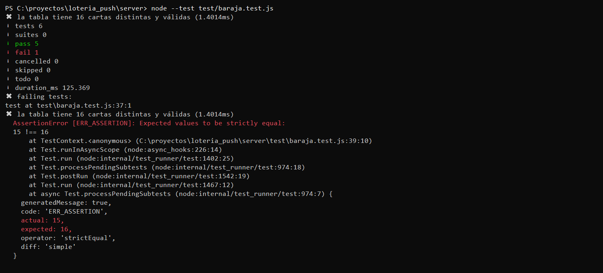

**VERDE** – Se revierte el cambio y las pruebas pasan

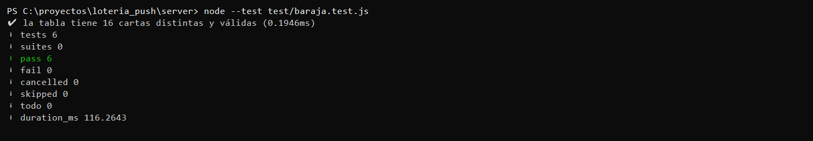

### Servidor 2 – Líneas para ganar

**Archivo de pruebas:** `server/test/lineas.test.js`

**Cambio para provocar el fallo:** `lineas.js`: la segunda diagonal se cambió de `[3, 6, 9, 12]` a `[3, 6, 9, 13]`.

**ROJO** – La prueba falla

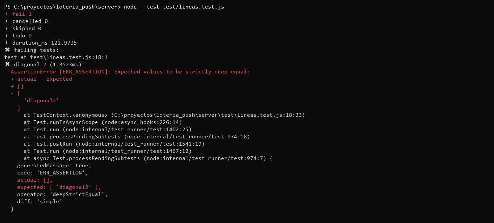

**VERDE** – Se revierte el cambio y las pruebas pasan

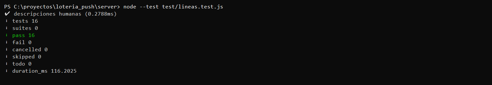

### Servidor 3 – Mensajes FCM

**Archivo de pruebas:** `server/test/mensajes.test.js`

**Cambio para provocar el fallo:** `mensajes.js`: la caducidad de una carta se cambió de 60 a 30 segundos.

**ROJO** – La prueba falla

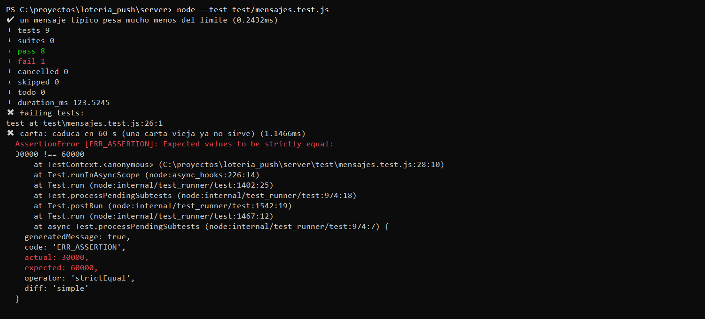

**VERDE** – Se revierte el cambio y las pruebas pasan


### Servidor 4 – Sala

**Archivo de pruebas:** `server/test/sala.test.js`

**Cambio para provocar el fallo:** `sala.js`: el error de sala llena se cambió de `SALA_LLENA` a `SALA_COMPLETA`.

**ROJO** – La prueba falla

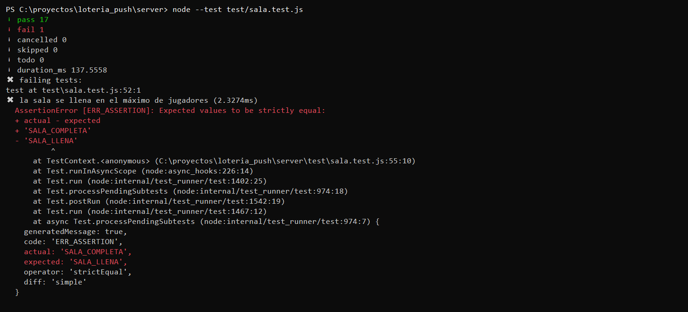

**VERDE** – Se revierte el cambio y las pruebas pasan

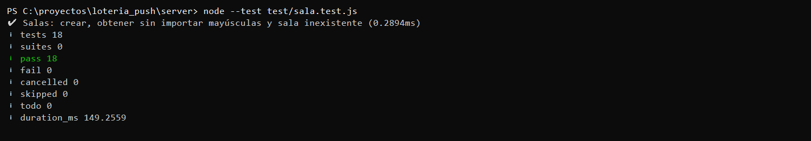

### Servidor 5 – Servidor HTTP

**Archivo de pruebas:** `server/test/servidor.test.js`

**Cambio para provocar el fallo:** `servidor.js`: al unirse a una sala se respondía `200` en lugar de `201`.

**ROJO** – La prueba falla

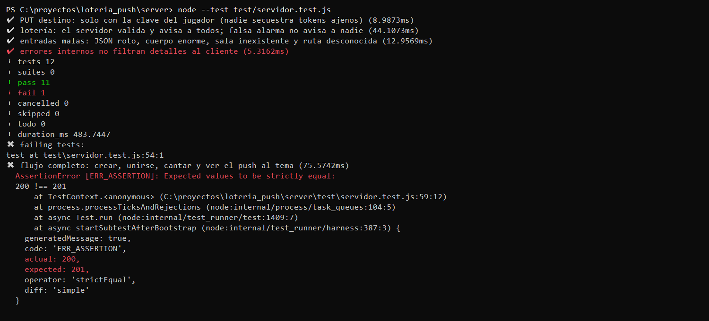

**VERDE** – Se revierte el cambio y las pruebas pasan

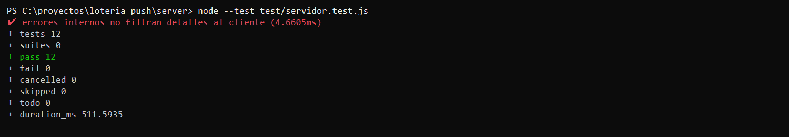

### App 1 – Eventos y líneas

**Archivo de pruebas:** `app/test/evento_lineas_test.dart`

**Cambio para provocar el fallo:** `lineas.dart`: la segunda diagonal se cambió de `[3, 6, 9, 12]` a `[3, 6, 9, 13]`.

**ROJO** – La prueba falla

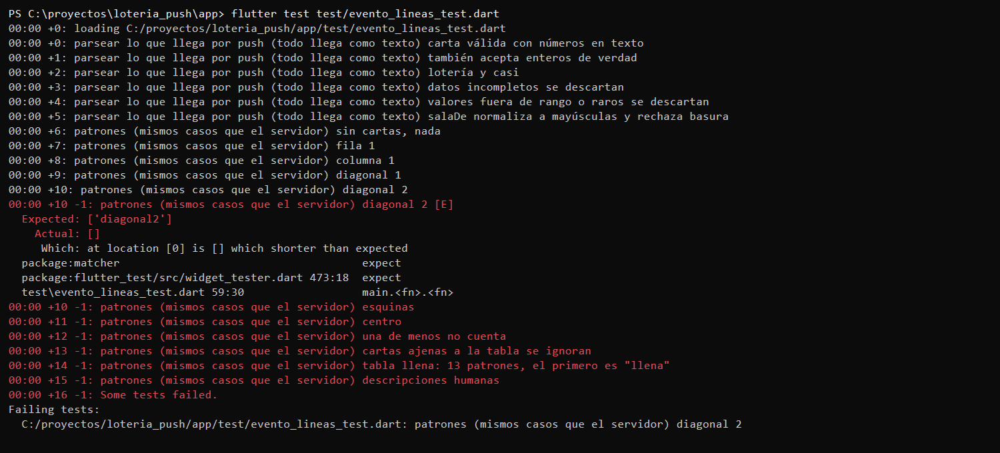

**VERDE** – Se revierte el cambio y las pruebas pasan

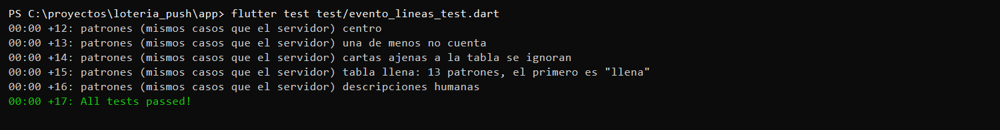

### App 2 – Partida

**Archivo de pruebas:** `app/test/partida_test.dart`

**Cambio para provocar el fallo:** `partida.dart`: la revisión de cartas repetidas se cambió de `c.n <= ultima` a `c.n < ultima`, así que una carta repetida ya no se reconocía como duplicada.

**ROJO** – La prueba falla

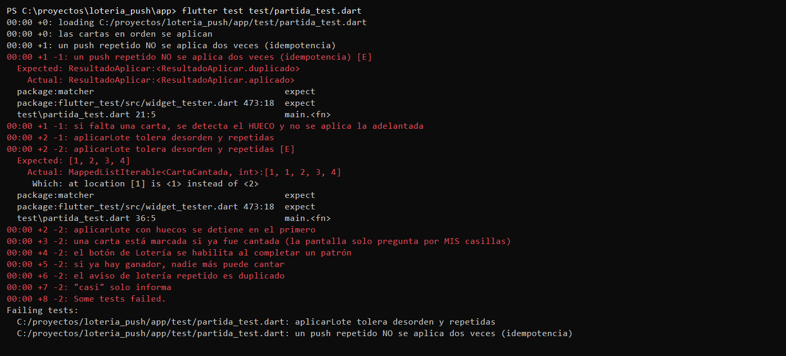

**VERDE** – Se revierte el cambio y las pruebas pasan

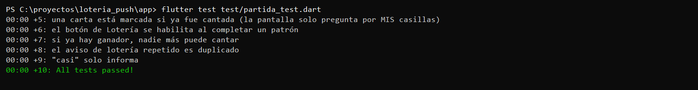

### App 3 – Controlador

**Archivo de pruebas:** `app/test/controlador_test.dart`

**Cambio para provocar el fallo:** `controlador.dart`: la suscripción al tema de la sala se hacía con `!avisosActivos`, o sea, al revés.

**ROJO** – La prueba falla

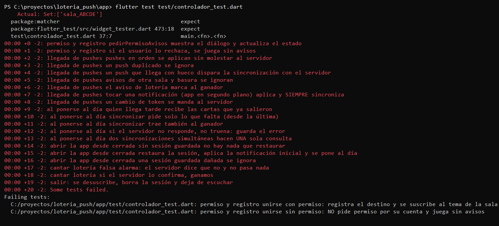

**VERDE** – Se revierte el cambio y las pruebas pasan

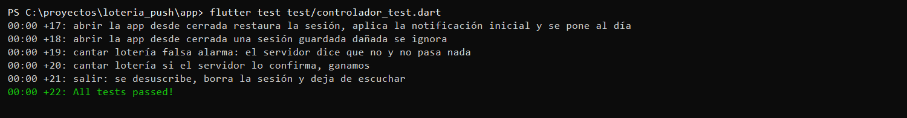

### App 4 – Pantalla

**Archivo de pruebas:** `app/test/pantalla_test.dart`

**Cambio para provocar el fallo:** `pantalla_juego.dart`: el botón ¡LOTERÍA! se dejó siempre deshabilitado (`onPressed: null`).

**ROJO** – La prueba falla

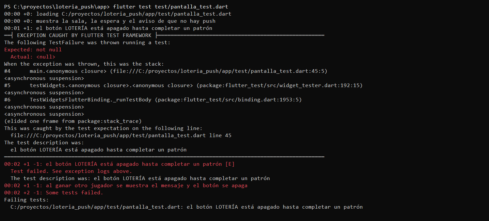

**VERDE** – Se revierte el cambio y las pruebas pasan

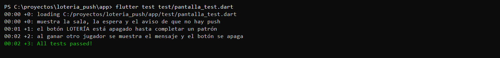

Al final, `node --test` pasa las 63 pruebas del servidor y `flutter test` pasa las 52 de la app (capturas en la sección de evidencia).

## Carpetas

```
server/
  baraja.js
  lineas.js
  mensajes.js
  sala.js
  enviador.js
  servidor.js
  package.json
  test/baraja.test.js
  test/lineas.test.js
  test/mensajes.test.js
  test/sala.test.js
  test/servidor.test.js
app/
  lib/
    dominio/almacen.dart
    dominio/api_juego.dart
    dominio/cartas.dart
    dominio/controlador.dart
    dominio/evento.dart
    dominio/lineas.dart
    dominio/partida.dart
    dominio/puerto_push.dart
    dominio/sesion.dart
    infra/almacen_prefs.dart
    infra/api_http.dart
    infra/canales_android.dart
    infra/fondo.dart
    infra/puerto_fcm.dart
    presentacion/pantalla_cantor.dart
    presentacion/pantalla_inicio.dart
    presentacion/pantalla_juego.dart
    presentacion/vms.dart
    app.dart
    main.dart
    main_demo.dart
  test/
    falsos.dart
    evento_lineas_test.dart
    partida_test.dart
    controlador_test.dart
    pantalla_test.dart
```

## Cómo correrlo

Se usan dos terminales. En la primera va el servidor (el cantor) en modo desarrollo:

```
cd server
npm test
npm run dev
```

`npm run dev` es igual que `npm start`, pero deja que la app web de `flutter run` (que sale en otro puerto de `localhost`) le hable al cantor (CORS solo para `localhost`). En `npm start` no se manda ninguna cabecera CORS.

En la segunda va la app sin Firebase (demo en el navegador):

```
cd app
flutter pub get
flutter test
flutter run -d edge -t lib/main_demo.dart
```

La demo busca al cantor en `http://localhost:8080`; si está en otra dirección se cambia con `--dart-define=CANTOR=http://...`. Para jugar se abren dos pestañas: en una se crea la sala como cantor y en la otra se une el jugador con el código.

Para el push de verdad hace falta un proyecto de Firebase propio: en `app/` se corre `flutterfire configure` (genera `lib/firebase_options.dart`, que no viene en el repo) y el servidor se arranca con `FCM_REAL=1` y `GOOGLE_APPLICATION_CREDENTIALS` apuntando al JSON de la cuenta de servicio. Ese JSON es secreto y nunca se sube al repositorio (está en el `.gitignore`).

## Evidencia

Resultado de `npm test` en el servidor (63 pruebas: 6 de la baraja, 16 de las líneas, 9 de los mensajes, 18 de la sala y 14 del servidor HTTP, 2 de ellas del modo `dev` con CORS para `localhost`):

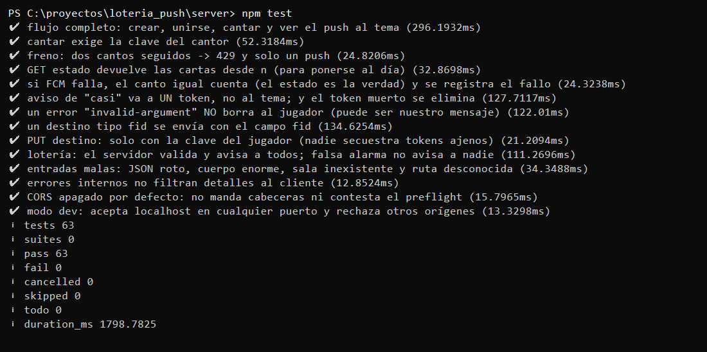

Resultado de `flutter test` en la app (52 pruebas: 17 de eventos y líneas, 10 de la partida, 22 del controlador y 3 de la pantalla):

```
PS C:\proyectos\loteria_push\app> flutter test
00:04 +52: All tests passed!
```

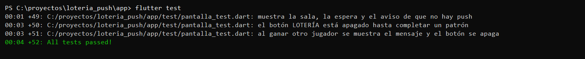

## Evidencia de la app funcionando

Se probó en el navegador con `main_demo.dart` y el servidor corriendo en modo push simulado. A la izquierda está el jugador y a la derecha el cantor.

Pantalla de inicio: crear sala (cantor) o unirse con el código:

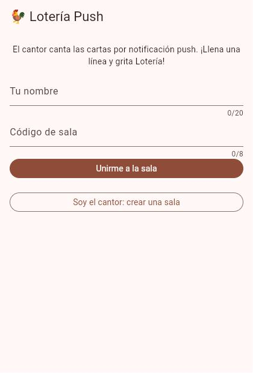

El cantor crea la sala y le sale el código para compartir; el jugador mete su nombre y ese código:

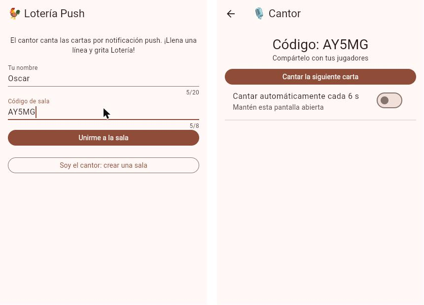

El jugador se une a la sala y recibe su tabla de 4×4. Como no hay permiso de push, sale el aviso de que la app revisa al cantor cada 5 s:

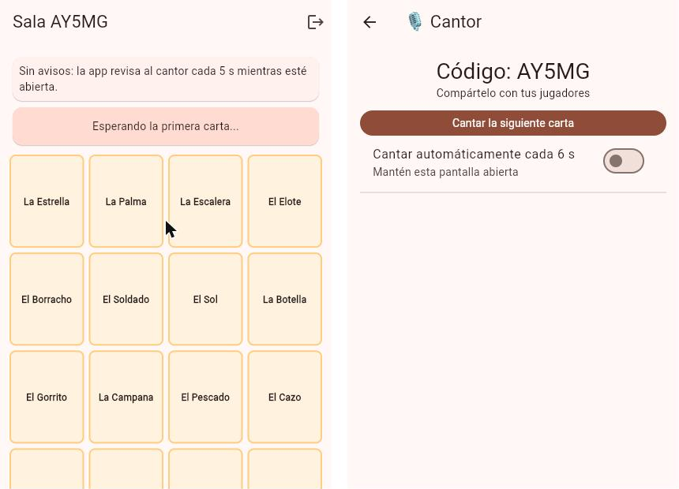

El cantor va cantando cartas y al jugador le llegan con su pista:

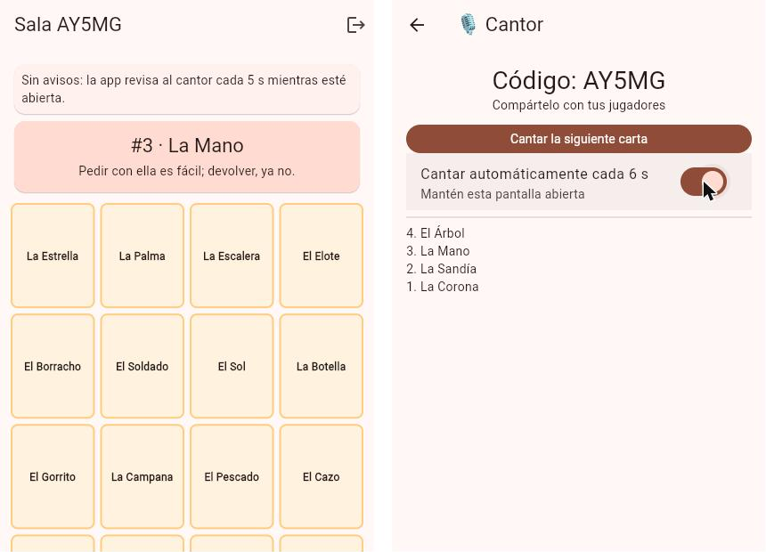

Las cartas cantadas que salen en la tabla del jugador se marcan con el frijol:

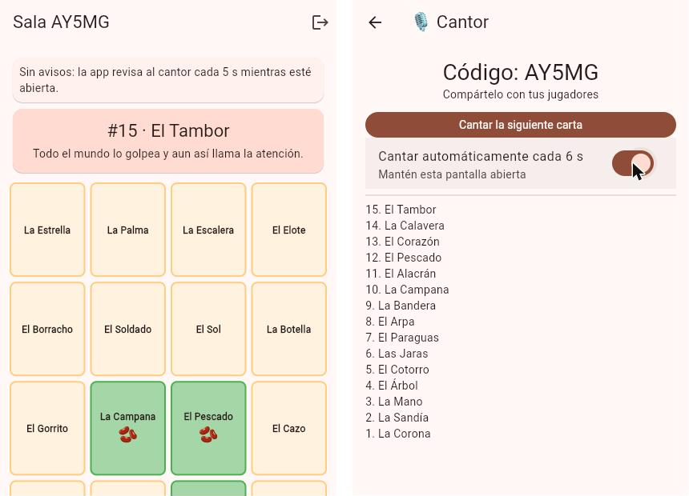

En la consola del servidor se ve cada push que se mandaría a FCM: al tema `sala_AY5MG`, con título, cuerpo y datos de la carta, prioridad alta, TTL de 60 s y `collapseKey` `carta_AY5MG`:

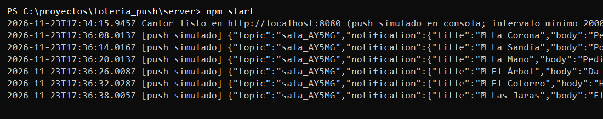
